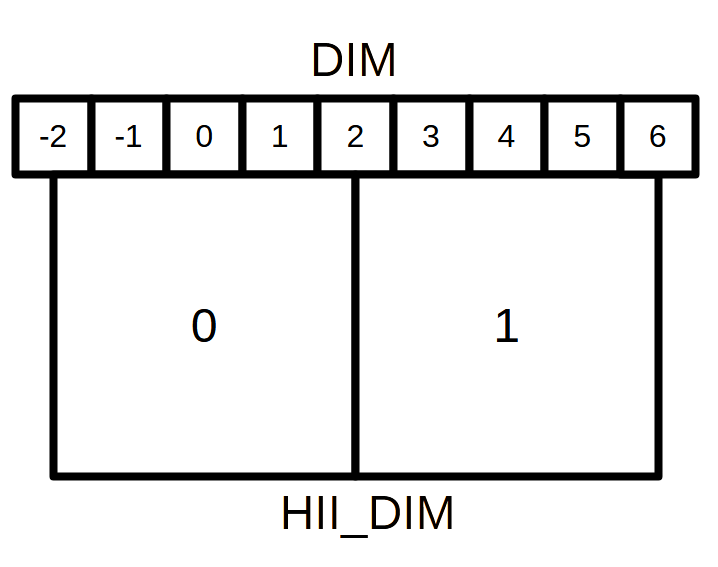

Developer Documentation
=======================

If you are new to developing ``21cmFAST``, please read the :ref:`contributing:Contributing`
section *first*, which outlines the general concepts for contributing to development,
and provides a step-by-step walkthrough for getting setup.
This page lists some more detailed notes which may be helpful through the
development process.

Compiling for debugging
-----------------------
When developing, it is usually a good idea to compile the underlying C code in ``DEBUG``
mode. This may allow extra print statements in the C, but also will allow running the C
under ``valgrind`` or ``gdb``. To do this::

    $ DEBUG=True pip install -e .

See :ref:`installation:Installation` for more installation options.

Developing the C Code
---------------------
In this section we outline how one might go about modifying/extending the C code and
ensuring that the extension is compatible with the wrapper provided here. It is
critical that you run all tests after modifying _anything_ (and see the section
below about running with valgrind). When changing C code, before
testing, ensure that the new C code is compiled into your environment by running::

    $ rm -rf build
    $ pip install .

Note that using a developer install (`-e`) is not recommended as it stores compiled
objects in the working directory which don't get updated as you change code, and can
cause problems later.

There are two main purposes you may want to write some C code:

1. An external plugin/extension which uses the output data from 21cmFAST.
2. Modifying the internal C code of 21cmFAST.

21cmFAST currently provides no support for external plugins/extensions. It is entirely
possible to write your own C code to do whatever you want with the output data, but we
don't provide any wrapping structure for you to do this, you will need to write your
own. Internally, 21cmFAST uses the ``cffi`` library to aid the wrapping of the C code into
Python. You don't need to do the same, though we recommend it. If your desired
"extension" is something that needs to operate in-between steps of 21cmFAST, you can use
the generators or single-field fucntions (see :ref:`tutorials/coeval_cubes`) to stop your
calculation at the desired point, making any modifications to the structures before continuing
the run.

Modifying the C-code of 21cmFAST should be relatively simple. If your changes are
entirely internal to a given function, then nothing extra needs to be done. A little
more work has to be done if the modifications add/remove input parameters or the output
structure. If any of the input structures are modified (i.e. an extra parameter
added to it), then the corresponding class in ``py21cmfast.wrapper`` must be modified,
usually simply to add the new parameter to the existing attributes using any desired
functionality provided in the ``attrs`` package.
For instance, if a new variable ``some_param`` was added to the ``matter_params`` struct
in the ``ComputeInitialConditions`` C function, then the ``MatterParams`` class in
the wrapper would be modified, adding``some_param=attrs.field(default=<your_value_here>)``
to the class. If the default value of the parameter is dependent on another parameter, it
should be placed after it's depenencies in the structure, and be given a default function
vit the attrs default decorator e.g::

    @DIM.default
    def _dim_default(self):
        return 3 * self.HII_DIM

Here we return either the explicitly set ``DIM``, or 3 by the ``HII_DIM``. In addition, if the
new parameter is not settable -- if it is completely determined by other parameters -- mark it as
private with a leading underscore or make it a ``@property`` of the class.

If you modify an output struct, which usually house a number of array quantities
(often float pointers, but not necessarily), then you'll again need to modify the
corresponding class in the wrapper. In particular, you'll need to add an entry for that
particular array as an ``_arrayfield()`` to the attributes the class and set its shape in the ``new()``
method. Any output which depends on the new array must also have it added to its
``get_required_input_arrays()`` method.

If the C backend uses new input or output fields, they must be added to the structs
in the header files ``_inputparams_wrapper.h`` or ``_outputstructs_wrapper.h``.

Changing the File Format
------------------------
Any change that affects what is written to (or read from) output files -- renaming,
adding or removing an input parameter, an output struct or one of its fields, or
changing the meaning of a field -- must be recorded as a change of the release in
which it will appear. This is what allows files written by older versions to be read
(and migrated with ``21cmfast migrate``), and it doubles as a changelog of the file
format.

The changes live in modules of ``src/py21cmfast/io/_compat/``, one for each release
that changed the format, named after the versions it converts between (e.g.
``_v4_2_v4_3.py`` converts files from the format of v4.2 to that of v4.3). Each
defines a ``RELEASE`` (with an explicit ``from_version`` and ``to_version``) built
from the kinds of change defined in ``src/py21cmfast/io/_compat_framework.py``
(renamed parameters, renamed fields, conversions, etc.), along with any helper
functions those changes need. To record changes for a new release, add a module for
it (converting from the last release that changed the format), and add its
``RELEASE`` to ``FORMAT_HISTORY`` in ``src/py21cmfast/io/_compat/__init__.py``.
Tests check that the history is a continuous chain, starting from the oldest version
whose files are still supported, and that the module names match the versions. Add a
test of each new change to ``tests/io/test_compat.py``.

Patch releases work the same way. A patch release that changes the format gets its
own module, with the patch version in its name (e.g. ``_v4_3_v4_3_1.py``, followed by
``_v4_3_1_v4_4.py``). A patch release that doesn't change the format needs nothing:
its files get every step converting to a later version.

Support for old files follows a deprecation policy: files from the previous major
version are deprecated (reading them warns), and files from older major versions are
not supported. When releasing a new major version N, nothing needs to be done for
files from N-1 (they become deprecated automatically). Support for files from N-2
must then be removed, by deleting the modules of ``_compat`` that convert *from*
version N-2 (including the one converting to N-1.0), along with their tests and
legacy-format descriptions. ``test_no_steps_from_unsupported_versions`` fails until
this is done.

The tests use descriptions of the files written by each older release, stored in
``tests/test_data/legacy_formats/``. After a release that changes the format, add a
description for it using the scripts in ``devel/legacy_formats/``.

C Function Standards
~~~~~~~~~~~~~~~~~~~~
The C-level functions are split into two groups -- low-level "private" functions, and
higher-level "public" or "API" functions. All API-level functions are callable from
python (but may also be called from other C functions). All API-level functions are
currently prototyped in ``_functionprototypes_wrapper.h``.

To enable consistency of error-checking in Python (and a reasonable standard for any
kind of code), we enforce that any API-level function which computes an output structure must return an integer status.
In addition, any "return" objects must be modified in-place (i.e. passed as pointers). This enables
Python to control the memory access of these variables, and also to receive proper
error statuses (see below for how we do exception handling). We also adhere to the
convention that "output" variables should be passed to the function as its last
argument(s). In the case that _only_ the last argument is meant to be "output", there
exists a simple wrapper ``_call_c_simple`` in ``wrapper/_utils.py`` that will neatly handle the
calling of the function in an intuitive pythonic way.

Coordinate Systems & Grid Resolution
~~~~~~~~~~~~~~~~~~~~~~~~~~~~~~~~~~~~
``21cmFAST`` Uses two grid resolutions specified in ``SimulationOptions`` during the simulation: A high-resolution ``DIM``
used to specify the ``InitialConditions``, which is downsampled to ``HII_DIM`` in the ``PerturbedField`` and is used
for all other fields. The two grids are aligned as follows (using a ratio of ``DIM`` / ``HII_DIM`` = 4 as an example):

When the ratio of the two grid dimensions is an integer, the centres of the low-resolution grid cells will always
align with the centre of a high resolution cell. This allows us to easily downsample the grids using Fourier-space filters,
since we can always place a low-pass filter at the centre of a high-resolution cell.

Continuous positions such as ``HaloCatalog.halo_coords`` are specified on the range [0, ``BOX_LEN``]. And wrapping occurs such that
the low-resolution cell at index 0 will contain the coordinates [``BOX_LEN(1 - 1/(2*HII_DIM))``, ``BOX_LEN``]
and [0, ``BOX_LEN/(2*HII_DIM)``].

Functions and macros regarding indexing and positioning in both continuous space and discrete grids can be found
in ``indexing.c`` and ``indexing.h``.

Performance and Memory Profiling
~~~~~~~~~~~~~~~~~~~~~~~~~~~~~~~~
The simplest way to profile the code is using the package `py-spy <https://github.com/benfred/py-spy>`
and `speedscope <https://speedscope.app>`, simply install py-spy and run

    ``py-spy record --format speedscope -o [PATH_TO_PROFILE].json -- python [YOUR_PYTHON_SCRIPT].py``.

Then drag the output JSON file into the speedscope web app to visualize the profiling data.

Profiling the backend functions requires you to pass the ``--native`` flag to ``py-spy``, and more
information will be available if you set ``PROFILE=TRUE`` when compiling ``21cmFAST``, which enables debug symbols.

(Note 12/08/25: We have found that some versions of py-spy may have issues using the the ``--native`` flag, displaying stack errors.
if you encounter this, try installing ``21cmFAST`` and ``py-spy`` on a Python 3.11 environment.)

Memory usage can also be profiled simply using `memray <https://github.com/bloomberg/memray>`. After installing memray:

    ``memray run -o [PATH_TO_PROFILE] python [YOUR_PYTHON_SCRIPT].py``
    ``memray flamegraph [PATH_TO_PROFILE]``

This will generate a HTML file that can be opened in a web browser to visualize memory usage.

Running with gperftools
~~~~~~~~~~~~~~~~~~~~~~~
profiling can also be achieved using gperftools by compiling 21cmfast with the ``PROFILE`` flag
then calling whichever script you use to run ``21cmFAST`` with the ``CPUPROFILE`` environment variable

    env CPUPROFILE=[PATH-TO-PROFILE] python some_script.py

Profiles may then be viewed using ``pprof``, and the shared library file (located in the build directory
after compiling), see https://gperftools.github.io/gperftools/cpuprofile.html for more information on pprof.
Profile graphs may have unnamed functions at the top-level, representing the wrapper. However the lower-level
functions will be mapped correctly.

Running with Valgrind
~~~~~~~~~~~~~~~~~~~~~
Much more detailed performance statistics can be obtained using valgrind, which explicitly
checks for memory leaks. To do this, install ``valgrind`` (we have tested v3.14+),
which is probably available via your package manager. We provide a
suppression file for ``valgrind`` in the ``devel/`` directory of the main repository.

It is ideal if you install a development-version of python especially for running these
tests. To do this, download the version of python you want and then configure/install with::

    $ ./configure --prefix=<your-home>/<directory> --without-pymalloc --with-pydebug --with-valgrind
    $ make; make install

Construct a ``virtualenv`` on top of this installation, and create your environment,
and install all requirements.

If you do not wish to run with a modified version of python, you may continue with your
usual version, but may get some extra cruft in the output. If running with Python
version > 3.6, consider running with environment variable ``PYTHONMALLOC=malloc``
(see https://stackoverflow.com/questions/20112989/how-to-use-valgrind-with-python ).

The general pattern for using valgrind with python is::

    $ valgrind --tool=memcheck --track-origins=yes --leak-check=full --suppressions=devel/valgrind-suppress-all-but-c.supp <python script>

One useful command is to run valgrind over the test suite (from the top-level repo
directory)::

    $ valgrind --tool=memcheck --track-origins=yes --leak-check=full --suppressions=devel/valgrind-suppress-all-but-c.supp pytest

While we will attempt to keep the suppression file updated to the best of our knowledge
so that only relevant leaks and errors are reported, you will likely have to do a bit of
digging to find the relevant parts.

Valgrind will likely run very slowly, and sometimes  you will know already which exact
tests are those which may have problems, or are relevant to your particular changes.
To run these::

    $ PYTHONMALLOC=malloc valgrind --tool=memcheck --track-origins=yes --leak-check=full --suppressions=devel/valgrind-suppress-all-but-c.supp pytest -v tests/<test_file>::<test_func> > valgrind.out 2>&1

Note that we also routed the stderr output to a file, which is useful because it can be
quite voluminous. There is a python script, ``devel/filter_valgrind.py`` which can be run
over the output (`valgrind.out` in the above command) to filter it down to only have
stuff from 21cmfast in it.

Producing Integration Test Data
~~~~~~~~~~~~~~~~~~~~~~~~~~~~~~~
There are bunch of so-called "integration tests", which rely on previously-produced
data. To produce this data, run ``python tests/produce_integration_test_data.py``.

Furthermore, this data should only be produced with good reason -- the idea is to keep
it static while the code changes, to have something steady to compare to. If a particular
PR fixes a bug which affects a certain tests' data, then that data should be re-run, in
the context of the PR, so it can be explained.

Logging in C
~~~~~~~~~~~~
The C code has a header file ``logging.h``. The C code should *never* contain bare
print-statements -- everything should be formally logged, so that the different levels
can be printed to screen correctly. The levels are defined in ``logging.h``, and include
levels such as ``INFO``, ``WARNING`` and ``DEBUG``. Each level has a corresponding macro
that starts with ``LOG_``. Thus to log run-time information to stdout, you would use
``LOG_INFO("message");``. Note that the message does not require a final newline character.
While there are several exceptions, a rule-of-thumb is to use ``DEBUG`` for output structure
level information (printed once per compute functino), ``SUPER_DEBUG`` for smaller loop
information (such as things once per filter radius), and ``ULTRA_DEBUG`` for individual cells
(hopefully not *every* cell).

Exception handling in C
~~~~~~~~~~~~~~~~~~~~~~~
There are various places that things can go wrong in the C code, and they need to be
handled gracefully so that Python knows what to do with it (rather than just quitting!).
We use the simple ``cexcept.h`` header file from http://www.nicemice.net/cexcept/ to
enable a simple form of exception handling. That file itself should **not be edited**.
There is another header -- ``exceptions.h`` -- that defines how we use exceptions
throughout ``21cmFAST``. Any time an error arises that can be understood, the developer
should add a ``Throw <ErrorKind>;`` line. The ``ErrorKind`` can be any of the kinds
defined in ``exceptions.h`` (eg. ``GSLError`` or ``ValueError``). These are just integers.

Any C function that computes an output struct -- *must* be globally wrapped in
a ``Try {} Catch(error_code) {}`` block. See ``GenerateICs.c`` for an example.
Most of the code should be in the ``Try`` block.
Anything that does a ``Throw`` at any level of the call stack within that ``Try`` will
trigger a jump to the ``Catch``. The ``error_code`` is the integer that was thrown.
Typically, one will perhaps want to do some cleanup here, and then finally *return* the
error code.

Python knows about the exit codes it can expect to receive, and will raise Python
exceptions accordingly. From the python side, two main kinds of exceptions could be
raised, depending on the error code returned from C. The lesser exception is called a
``ParameterError``, and is supposed to indicate an error that happened merely because
the parameters that were input to the calculation were just too extreme to handle.
In the case of something like an automatic Monte Carlo algorithm that's iterating over
random parameters, one would *usually* want to just keep going at this point, because
perhaps it just wandered too far in parameter space.
The other kind of error is a ``FatalCError``, and this is where things went truly wrong,
and probably will do for any combination of parameters.

If you add a kind of Exception in the C code (to ``exceptions.h``), then be sure to add
a handler for it in the ``_process_exitcode`` function in ``wrapper.py``.

Maintaining Array State
~~~~~~~~~~~~~~~~~~~~~~~
Part of the challenge of maintaining a nice wrapper around the fast C-code is keeping
track of initialized memory, and ensuring that the C structures that require that memory
are pointing to the right place. Most of the arrays that are computed in ``21cmFAST``
are initialized *in Python* (using Numpy), then a pointer to their memory is given to
the C wrapper object.

To make matters more complicated, since some of the arrays are really big, it is sometimes
necessary to write them to disk to relieve memory pressure, and load them back in as required.
That means that any time, a given array in a C-based class may have one of several different "states":

1. Completely Uninitialized
2. Allocated an initialized in memory
3. Computed (i.e. filled with the values defining that array after computation in C)
4. Stored on disk
5. Stored *and* in memory.

It's important to keep track of these states, because when passing the struct to the ``compute()``
function of another struct (as input), we go and check if the array exists in memory, and
initialize it. Of course, we shouldn't initialize it with zeros if in fact it has been computed already
and is sitting on disk ready to be loaded. Thus, the ``OutputStruct`` tries to keep track of these
states for every array in the structure, using the ``Array`` and ``ArrayState`` classes. Every write/read/compute/purge
operation self-consistently modifies the status of the array.

It has been made difficult to unintnetionally modify the data in an array without properly changing the state.
Arrays are frozen structures, so one must use the methods provided to alter their values or states.

Purging/Loading C-arrays to/from Disk
~~~~~~~~~~~~~~~~~~~~~~~~~~~~~~~~~~~~~
As of v3.1.0, there are more options for granular I/O, allowing large arrays to be purged from memory
when they are unnecessary for further computation. As a developer, you should be aware of the ``_get_required_input_arrays``
method on all ``OutputStruct`` subclasses. This is available to tell the given class what arrays need to
be available at compute time in any of the input structs. For example, if doing ``PERTURB_ON_HIGH_RES``,
the ``PerturbedField`` requires the hi-res density fields in ``InitialConditions``. This gives indications
as to what boxes can be purged to disk (all the low-res boxes in the ICs, for example).
Currently, this is only used to *check* that all boxes are available at compute time, and is not used
to actually automatically purge anything. Note however that ``InitialConditions`` does have two
custom methods that will purge unnecessary arrays before computing perturb fields or ionization fields.

.. note:: If you add a new quantity to a struct, and it is required input for other structs, you need
          to add it to the relevant ``_get_required_input_arrays`` methods.

Further note that as of v3.1.0, partial structs can be written and read from disk (so you can specify
``keys=['hires_density']`` in the ``.read()`` method to just read the hi-res density field into the object.

Branching and Releasing
-----------------------
The aim is to make 21cmFAST's releases as useful, comprehendible, and automatic
as possible. This section lays out explicitly how this works (mostly for the benefit of
the admin(s)).

Versioning
~~~~~~~~~~
The first thing to mention is that we use strict `semantic versioning <https://semver.org>`_
(since v2.0). Thus the versions are ``MAJOR.MINOR.PATCH``, with ``MAJOR`` including
API-breaking changes, ``MINOR`` including new features, and ``PATCH`` fixing bugs or
documentation etc. If you depend on 21cmFAST, you can set your dependency as
``21cmFAST >= X.Y < X+1`` and not worry that we'll break your code with an update.

To mechanically handle versioning within the package, we use
`setuptools-scm <https://pypi.org/project/setuptools-scm/>`_. This stores the version
in the git tag. There are many benefits to this -- one is that the version is unique
for every single change in the code, with commits on top of a release changing the
version. This means that versions accessed via ``py21cmfast.__version__`` are unique and track
the exact code in the package (useful for reproducing results). To get the current
version from command line, simply do ``python -m setuptools-scm`` in the top-level
directory.

Branching
~~~~~~~~~
We keep two kinds of long-lived branches:

* ``main`` is where development happens. It holds the code for the next ``MINOR``
  release (e.g. v4.4.0).
* ``release-vX.Y.x`` (e.g. ``release-v4.3.x``) is a maintenance branch for the
  ``X.Y`` release series. It is created from the ``vX.Y.0`` tag, and all ``vX.Y.Z``
  patch releases are made from it. It only ever receives bug fixes.

Here ``X``, ``Y`` and ``Z`` stand for version numbers, while the lowercase ``x`` in
``release-vX.Y.x`` is literally part of the branch name (e.g. ``release-v4.3.x``): a
single branch serves all the patch releases of a series, each of which is a ``vX.Y.Z``
tag on it.

**Which branch to target.** Every change is made on a short-lived branch and merged
through a pull request. If your change fixes a bug that affects the latest release,
open the pull request against ``release-vX.Y.x``. Everything else -- new features,
refactors, and fixes to code that only exists on ``main`` -- goes against ``main``.

**Making a patch release.** Create the GitHub release with the tag ``vX.Y.Z`` and
choose ``release-vX.Y.x`` (not ``main``) as its target. Publishing the release
triggers the deployment to PyPI.

**Bringing fixes into main.** Fixes merged into ``release-vX.Y.x`` must also reach
``main``, otherwise they would be missing from the next ``MINOR`` release. To do so,
open a pull request that merges ``release-vX.Y.x`` into ``main``, at least after each
patch release. If it has conflicts, resolve them on a temporary branch created from
``main``::

    git checkout -b merge-release-vX.Y.x origin/main
    git merge origin/release-vX.Y.x  # resolve the conflicts and commit
    git push -u origin merge-release-vX.Y.x

and open the pull request from that branch instead. Never resolve the conflicts on
``release-vX.Y.x`` itself, and never merge ``main`` into ``release-vX.Y.x``: either
would bring unreleased features into the patch releases. If a fix was merged into
``main`` first and is also needed in the release series, copy just that commit with
``git cherry-pick -x <commit>`` onto a branch created from ``release-vX.Y.x``, and open
a pull request against ``release-vX.Y.x``.

**Lifetime of release branches.** Release branches are not deleted when they are
merged into ``main``: a repository ruleset protects all ``release-v*.x`` branches from
deletion and force-pushes. Once ``vX.Y+1.0`` is released, a new ``release-vX.Y+1.x``
branch is created from its tag, so that fixes for the new series have a home straight
away.

By default, the ``X.Y`` series is no longer supported once ``vX.Y+1.0`` is released:
new fixes go to ``release-vX.Y+1.x`` only, and no further ``vX.Y.Z`` releases are
made. Support can be extended for a while if there is a reason to (e.g. if
``vX.Y+1.0`` removes features that were deprecated in ``X.Y``, or a serious bug is
found shortly after the new release).

Once the ``X.Y`` series is no longer supported, retire its branch as follows:

1. Make sure that ``main`` contains all of its fixes. The following should print
   nothing; if it doesn't, do a final merge into ``main`` first::

    git fetch origin
    git log --oneline origin/main..origin/release-vX.Y.x

2. In the repository settings (Settings → Rules → Rulesets), add
   ``refs/heads/release-vX.Y.x`` as an exclusion to the ruleset that protects the
   release branches. Do not disable the whole ruleset, as it also protects the
   current release branch.
3. Delete the branch with ``git push origin --delete release-vX.Y.x``, and then
   remove the exclusion from the ruleset.

The releases of the ``X.Y`` series remain available through their tags.
